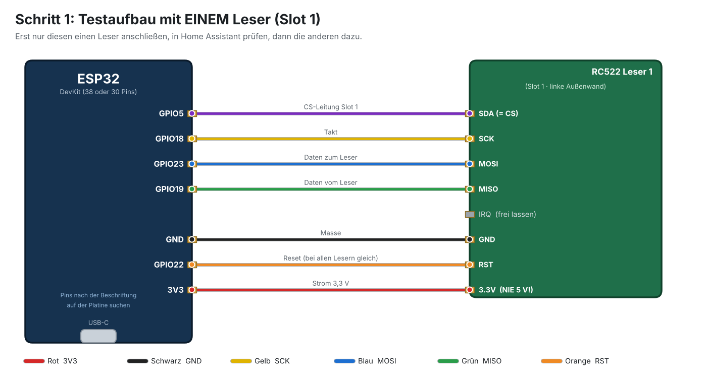
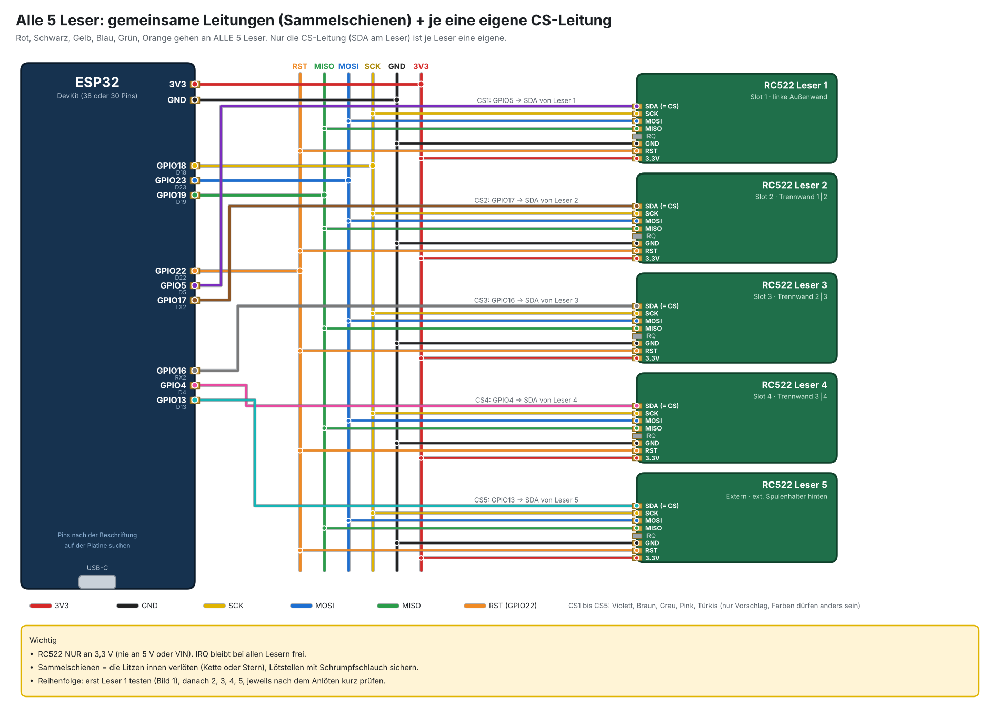
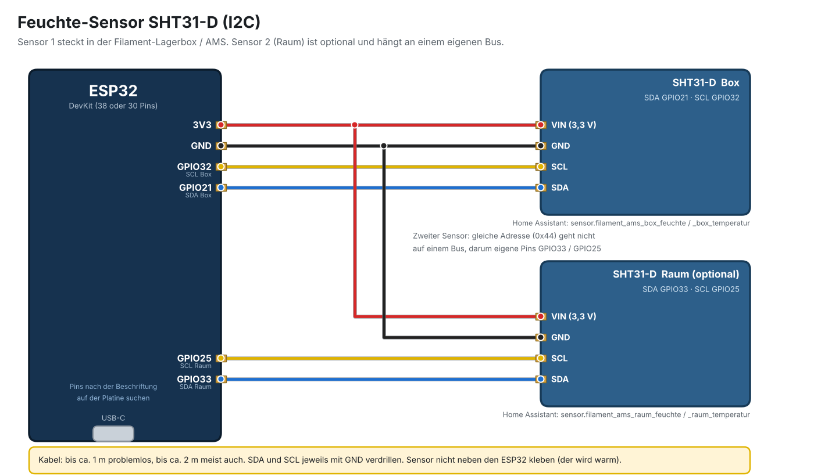
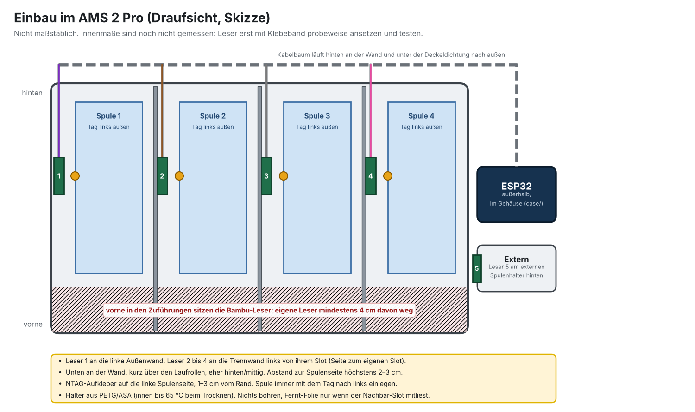

# FilamentHub: NFC-Leser und Feuchte-Sensor im AMS

Aufbau-Anleitung · Stand 1.115 · 30.10.2026

**So läuft es:** Ein ESP32 liest 5 NFC-Leser (Slot 1 bis 4 und extern) und 1 bis 2 Feuchte-Sensoren. Er schickt die Werte per WLAN an Home Assistant. Die FilamentHub-App holt sie dort ab, ordnet Spule und Slot zu und warnt bei zu hoher Feuchte.

> **Hinweis:** Bambu-Spulen bekommen KEINEN eigenen Tag. Das AMS liest ihren Chip selbst, die App liest nur mit. Nur Spulen anderer Marken (Sunlu, Eryone, Polymaker …) bekommen einen NTAG-Aufkleber.

## 1. Reihenfolge für heute

1. Teile prüfen (Liste unten).
2. ESP32 flashen: nur per USB, noch nichts angeschlossen (Kapitel 6).
3. EINEN Leser anschließen (Bild 1), Tag davorhalten, in Home Assistant prüfen.
4. Feuchte-Sensor anschließen (Bild 3), Wert in Home Assistant prüfen.
5. Restliche Leser anlöten (Bild 2). Nach jedem Leser kurz testen.
6. Teile drucken: Halter, ESP32-Gehäuse, Sensor-Box (Kapitel 4).
7. Einbau im AMS (Bild 4): erst mit Klebeband probeweise, dann fest.
8. Tags auf die Spulen kleben, in der App zuordnen (Kapitel 9).

## 2. Das brauchst du

| Teil | Menge | Hinweis |
|---|---|---|
| ESP32 (WROOM-32, USB-C, CH340) | 1 | Zweiter ist Ersatz. Windows braucht evtl. den CH340-Treiber. |
| RC522 Leser (Binghe) | 5 | NUR 3,3 V. Stiftleiste nicht einlöten, Litzen direkt anlöten. |
| SHT31-D Sensor (ARCELI) | 1 bis 2 | Pins: VIN, GND, SCL, SDA. Zweiter ist für den Raum (optional). |
| Silikonlitze 26 AWG | mehrere Farben | Farben nur Vorschlag. Notier dir, welche Farbe wohin geht. |
| Jumper-Kabel (ELEGOO) | einige | Für den Testaufbau auf dem Tisch. |
| Lötkolben, Lötzinn, Schrumpfschlauch | – | Jede Lötstelle mit Schrumpfschlauch sichern. |
| NTAG-Aufkleber | 1 je Fremdspule | Nicht für Bambu-Spulen. |
| PETG oder ASA Filament | – | Halter und Gehäuse. Im AMS wird es bis 65 °C warm. |
| Hitzefestes Klebeband (3M VHB) | 1 Rolle | Normales Klebeband und Isolierband lösen sich. |
| Ferrit-Folie ca. 50 × 60 mm | optional | Erst kaufen, wenn ein Leser den Nachbar-Slot mitliest. |
| USB-C Datenkabel + 5-V-Netzteil | 1 | Dauerstrom für den ESP32 in Reichweite des AMS. |
| Messschieber | 1 | Board-Maße von ESP32 und SHT31-D prüfen vor dem Druck. |
| Home Assistant + Add-on „ESPHome Device Builder“ | – | Hast du schon (Pi). Chrome oder Edge am PC fürs Flashen. |

## 3. Dateien (Ordner hardware/ams-nfc im Repo)

| Datei | Was |
|---|---|
| filament-ams.yaml | ESPHome-Konfiguration für den ESP32 (fertig, von ESPHome 2026.10.1 als gültig geprüft) |
| sensor-box/sensor_box_base.stl, sensor_box_lid.stl | Mini-Gehäuse für den SHT31-D (Unterteil + Deckel) |
| case/esp32_case_base.stl, esp32_case_lid.stl | Gehäuse für den ESP32 (Unterteil + Deckel) |
| holder/rc522_holder.stl | Halter für einen RC522, 44 × 64 × 5 mm (5 Stück) |
| holder/rc522_holder_flach.stl | Dünne Version, 2,4 mm, ohne Ferrit-Mulde |
| wiring/*.png und *.svg | Die vier Diagramme aus dieser Anleitung |

## 4. Drucken

| Teil | Material | Einstellung | Lage auf dem Bett |
|---|---|---|---|
| Halter × 5 | PETG / ASA | 0,2 mm, 3 Wände, ohne Stützen | flach |
| ESP32-Gehäuse | PETG / ASA | 0,2 mm, 3 Wände, ohne Stützen | Unterteil: Boden unten. Deckel: Außenseite unten |
| Sensor-Box × 1 bis 2 | PLA reicht in der Lagerbox, im AMS PETG / ASA | 0,4 mm Düse, 0,12 bis 0,16 mm, ohne Stützen | Unterteil: Boden unten. Deckel: flache Seite unten |

> **Hinweis:** Vor dem Druck messen: Das ESP32-Gehäuse passt für ein 38-Pin-DevKit mit 28,5 × 55 mm. Die Sensor-Box ist für ein Board von 13 × 16 mm eingestellt (kleiner geht auch). Ist ein Board größer, in build_case.py bzw. build_sensor_box.py die Werte bw und bl ändern und neu bauen.

## 5. Verkabelung

Die Diagramme zeigen die **Reihenfolge der Leitungen**, nicht die Lage der Pins auf dem Board. Such jeden Pin auf deinem ESP32 nach der aufgedruckten Beschriftung (zum Beispiel D18, D23, 3V3). GPIO17 heißt auf vielen Boards TX2, GPIO16 heißt RX2.

## RC522 an ESP32

| RC522-Pin | ESP32-Pin | gilt für |
|---|---|---|
| 3.3V | 3V3 | alle 5 Leser gemeinsam |
| GND | GND | alle 5 Leser gemeinsam |
| SCK | GPIO18 | alle 5 Leser gemeinsam |
| MOSI | GPIO23 | alle 5 Leser gemeinsam |
| MISO | GPIO19 | alle 5 Leser gemeinsam |
| RST | GPIO22 | alle 5 Leser gemeinsam |
| IRQ | frei lassen | – |
| SDA (= CS) Leser 1 / Slot 1 | GPIO5 | einzeln |
| SDA (= CS) Leser 2 / Slot 2 | GPIO17 (TX2) | einzeln |
| SDA (= CS) Leser 3 / Slot 3 | GPIO16 (RX2) | einzeln |
| SDA (= CS) Leser 4 / Slot 4 | GPIO4 | einzeln |
| SDA (= CS) Leser 5 / Extern | GPIO13 | einzeln |

## SHT31-D an ESP32

| Sensor-Pin | Sensor Box | Sensor Raum (optional) |
|---|---|---|
| VIN | 3V3 | 3V3 |
| GND | GND | GND |
| SDA | GPIO21 | GPIO33 |
| SCL | GPIO32 | GPIO25 |

GPIO22 ist schon RST der Leser, darum liegt SCL der Box auf GPIO32. Der Raum-Sensor hat einen eigenen Bus, weil beide Sensoren die Adresse 0x44 haben.

- **Nur 3,3 V** an die RC522. Nie an 5 V oder VIN.
- Sensor nicht direkt neben den ESP32 kleben, der wird warm und der Sensor misst dann zu wenig Feuchte.
- Sensor-Kabel: bis ca. 1 m problemlos, bis ca. 2 m meist auch. SDA und SCL mit GND verdrillen.
- Bei Aussetzern der Leser: Kabel kürzen und SCK, MOSI, MISO mit einer GND-Litze verdrillen.

### Bild 1: Testaufbau mit einem Leser



### Bild 2: Alle 5 Leser



### Bild 3: Feuchte-Sensor



### Bild 4: Einbau im AMS (Skizze, nicht maßstäblich)



## 6. ESP32 aufspielen (ESPHome)

1. In Home Assistant das Add-on **ESPHome Device Builder** öffnen.
2. **New Device**, Name `filament-ams`, Typ ESP32. Bei „Set up Wi-Fi“ dein WLAN eintragen (dann sind `wifi_ssid` und `wifi_password` schon als Secrets da).
3. **Wichtig vor dem Ersetzen:** In der automatisch erzeugten Datei stehen ein API-Schlüssel (Zeile `key:` unter `api` / `encryption`) und ein OTA-Passwort. Beide kopieren.
4. Oben rechts **Secrets** öffnen und eintragen: `filament_ams_api_key` (der kopierte Schlüssel) und `filament_ams_ota` (das kopierte Passwort oder ein eigenes).
5. Den ganzen Inhalt der Datei durch `filament-ams.yaml` ersetzen und speichern.
6. ESP32 per USB-C an den PC, **Install**, **Plug into this computer**. Das erste Mal dauert einige Minuten.
7. Fertig: In Home Assistant unter **Einstellungen, Geräte & Dienste, ESPHome** erscheint „filament-ams“. Auf **Hinzufügen** klicken, den API-Schlüssel eingeben.

```yaml
# Secrets (nur Beispiel, keine echten Werte):
wifi_ssid: "DeinWLAN"
wifi_password: "dein-wlan-passwort"
filament_ams_api_key: "<der Schlüssel aus der erzeugten Datei>"
filament_ams_ota: "<das OTA-Passwort>"
```

> **Hinweis:** Fehlt „Plug into this computer“ oder ist es grau? Das geht nur, wenn Home Assistant über https oder localhost geöffnet ist und du Chrome oder Edge nutzt. Dann: Install, Manual download, Factory format. Die .bin-Datei auf https://web.esphome.io öffnen, Connect, Port wählen, Install. Erkennt Windows den ESP32 nicht: CH340-Treiber installieren und ein Datenkabel nehmen (kein reines Ladekabel).

Danach geht jedes Update drahtlos („Wirelessly“). Zum Testen kannst du `remove_after` in der YAML kurz auf `10s` stellen, damit ein Slot nach dem Wegnehmen des Tags schnell leer wird. Danach zurück auf `10min` (die Spule dreht sich beim Drucken).

## 7. Testen

1. Home Assistant, **Entwicklerwerkzeuge, Zustände**, Filter `filament_ams`.
2. Du siehst: `sensor.filament_ams_slot_1_tag` bis `_slot_5_tag`, `_box_feuchte`, `_box_temperatur`, `_raum_feuchte`, `_raum_temperatur`, `_ip`, `_wlan_signal`, `_esp32_temperatur`.
3. NTAG-Aufkleber 2 bis 3 cm vor Leser 1 halten. `slot_1_tag` zeigt die Nummer, zum Beispiel `04-A1-B2-C3-D4-E5-F6`.
4. Warm die Hand über den Sensor halten: Temperatur und Feuchte steigen.
5. Ist alles gut, den nächsten Leser anlöten. Immer nur einen Schritt auf einmal.

> **Hinweis:** Beim Test mit einem Leser meldet der ESP32 im Log Fehler für Leser 2 bis 5 und evtl. für den zweiten Sensor. Das ist normal, die sind noch nicht angeschlossen. Eine Bambu-Spule im Slot steht nur als „fremder Tag ignoriert“ im Log. Auch normal.

## 8. Fehlersuche

| Problem | Prüfen |
|---|---|
| Leser erkennt keinen Tag | 3V3 und GND? MISO und MOSI nicht vertauscht? Abstand unter 2 bis 3 cm? Wirklich ein NTAG (kein Bambu-Chip)? Log in ESPHome ansehen. |
| Alle Leser tot, einer geht | Gemeinsame Leitung (SCK, MOSI, MISO, RST, 3V3, GND) an dem Leser unterbrochen? Lötstellen prüfen. |
| Ein Leser tot, andere gehen | SDA-Leitung (CS) dieses Lesers an den richtigen GPIO? Kaltlötstelle? |
| Leser liest den Nachbar-Slot mit | Ferrit-Folie hinter den Leser, 5-mm-Halter nutzen, Leser weiter nach hinten setzen. |
| Sensor „nicht verfügbar“ | SDA und SCL vertauscht? Im ESPHome-Log steht nach dem Start, welche I2C-Adresse gefunden wurde (erwartet 0x44). Kabel kürzen. |
| Feuchte springt oder ist zu niedrig | Sensor weg vom ESP32 und von Trockenmittel-Päckchen. Kabel verdrillen. |
| Slot wird nach einer Weile „leer“ | Normal: nach `remove_after` (10 min) ohne Tag gilt der Slot als leer. |
| ESP32 nicht im WLAN | Secrets prüfen. Fällt er zurück, macht er das WLAN „Filament-AMS Setup“ auf. |

## 9. Einbau im AMS 2 Pro

- **Wohin:** Leser 1 an die linke Außenwand innen, Leser 2 bis 4 an die Trennwand links von ihrem Slot (Seite zum eigenen Slot), Leser 5 am externen Spulenhalter hinten.
- **Lage:** unten an der Wand, kurz über den Laufrollen, eher hinten und mittig. Mindestens ca. 4 cm Abstand zu den Bambu-Lesern vorne in den Zuführungen, sonst stören sich die Leser (gleiche Funkfrequenz).
- **Abstand zur Spule:** höchstens 2 bis 3 cm. Platine im 5-mm-Halter, flach an die Wand.
- **Kleben:** 3M VHB oder hitzefestes Klebeband (innen bis 65 °C). Nichts bohren.
- **Kabel:** dünne Litzen flach an der Wand nach hinten, unter der Deckeldichtung hinaus. ESP32 außen im Gehäuse.
- **Tag auf die Spule:** NTAG auf die linke Spulenseite, 1 bis 3 cm vom Rand. Spule immer mit dem Tag nach links einlegen.
- **Gelesen wird beim Drehen:** Der Tag kommt bei jeder Umdrehung am Leser vorbei. Eine neue Fremd-Spule erkennt die App spätestens kurz nach dem Druckstart.
- **Zuerst probieren:** Leser mit Klebeband ansetzen, Tag drehen, in Home Assistant prüfen. Erst wenn es klappt, fest kleben.

## 10. In der App

- Home Assistant muss in der App verbunden sein (Verbindungen, Home Assistant). Dann findet sie die Sensoren `sensor.filament_ams_slot_1_tag` bis `slot_5_tag` selbst.
- **Bekannter Tag:** Die Spule wird dem Slot zugeordnet. Passt der Slot im Drucker nicht, schickt die App Material und Farbe (Entwickler-Modus nötig).
- **Unbekannter Tag:** Die App meldet „Unbekannter Tag in Slot X“. Wähl im Slot einmal die Spule aus, dann merkt sie sich den Tag.
- **Feuchte:** Mitteilungen, Einstellungen, Luftfeuchte. Standard: Alarm ab 25 %, AMS trocknet automatisch ab 30 %. Die App kennt `sensor.filament_ams_box_feuchte` schon.
- **Bambu-Spulen:** Neue Bambu-Spule im AMS, dann fragt die App „Als neue Spule anlegen“ (alles vorausgefüllt) oder „Ist schon in der App“.

## 11. Was noch nicht getestet ist

- Die ESPHome-Konfiguration ist von ESPHome 2026.10.1 als gültig geprüft. Die Firmware selbst wurde nicht kompiliert, nicht geflasht und nicht an echten Lesern probiert.
- Die AMS-Innenmaße sind nicht gemessen. Wie viel Platz an Wand und Trennwand ist, zeigt erst der Test.
- Ob ein Leser an der Trennwand den Nachbar-Slot mitliest, ist offen. Zuerst Slot 1 an der Außenwand testen.
- Die Board-Maße von ESP32 und SHT31-D musst du vor dem Druck messen.
- Wie lang die Kabel zwischen ESP32 und Lesern sein dürfen, hängt vom Aufbau ab. Bei Aussetzern Kabel kürzen und verdrillen.
