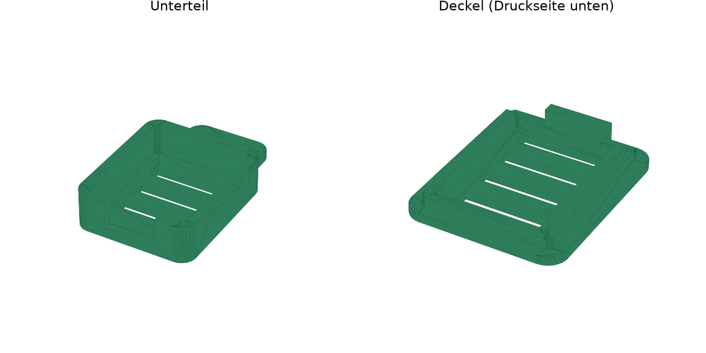

# Mini-Box für den Feuchte-Sensor (SHT31-D)

Kleines Gehäuse für das 4-Pin-SHT31-D-Modul (VIN, GND, SCL, SDA). Außen ca. **16 × 19 × 8 mm** (mit Lasche 26 mm lang).



## Dateien

| Datei | Was |
|---|---|
| `sensor_box_base.stl` | Unterteil mit Auflage, Kabelschlitz, Lüftungsschlitzen (Seiten + Boden) und Lasche (Loch 3,4 mm) |
| `sensor_box_lid.stl` | Deckel zum Aufklemmen, Lüftungsschlitze, zwei Rippen halten das Board |
| `build_sensor_box.py` | Erzeugt beide STL und prüft, dass Board und Deckel nirgends anstoßen |

## Vorher messen

Board-Maße mit dem Messschieber prüfen und oben in `build_sensor_box.py` eintragen (`bw`, `bl`), dann neu bauen:

```bash
pip install trimesh manifold3d matplotlib
python3 build_sensor_box.py
```

Eingestellt ist 13 × 16 mm. Ist das Board kleiner, passt es trotzdem (die Rippen halten es).

## Drucken

- PETG oder PLA, 0,4-mm-Düse, 0,12–0,16 mm Schichthöhe, ohne Stützen.
- Unterteil mit dem Boden aufs Bett, Deckel mit der flachen Seite aufs Bett.
- Nicht ins AMS (bis 65 °C beim Trocknen): für die Lagerbox reicht PLA, im AMS PETG/ASA.

## Einbau

1. Stiftleiste nicht einlöten. 4 Litzen (26 AWG) direkt an VIN, GND, SCL, SDA löten.
2. Board mit dem Sensor nach oben ins Unterteil legen, Kabel durch den Schlitz an der Pin-Seite.
3. Deckel aufdrücken. Der Steg am Deckel klemmt die Kabel im Schlitz (Zugentlastung).
4. Mit doppelseitigem Klebeband oder über die Lasche (Schraube / Kabelbinder) in der Box befestigen.

**Nicht** direkt auf ein Trockenmittel-Päckchen legen und nicht neben den ESP32 (der wird warm, misst dann zu wenig Feuchte).

## Kabel

- I2C ist für kurze Wege gemacht: **bis ca. 1 m** problemlos, bis ca. 2 m meist auch (in der YAML läuft der Bus deshalb nur mit 50 kHz).
- SDA und SCL am besten jeweils mit GND verdrillen. Bei Aussetzern: Kabel kürzen.
- Zweiter Sensor (Raum) hängt an einem eigenen Bus (SDA GPIO33, SCL GPIO25), weil der SHT31-D eine feste Adresse hat.
